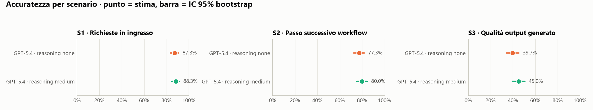
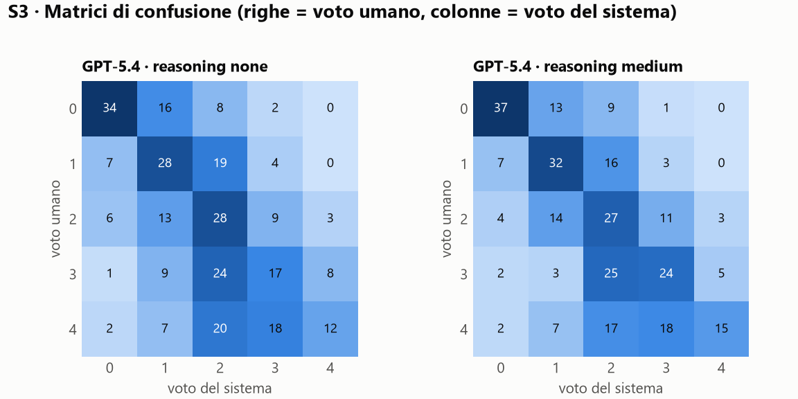
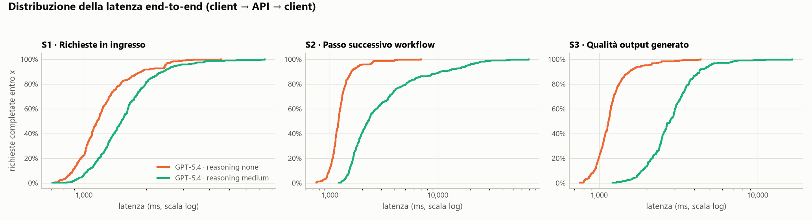
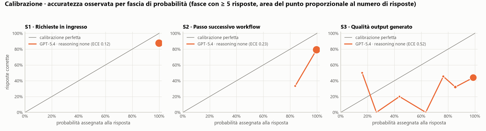
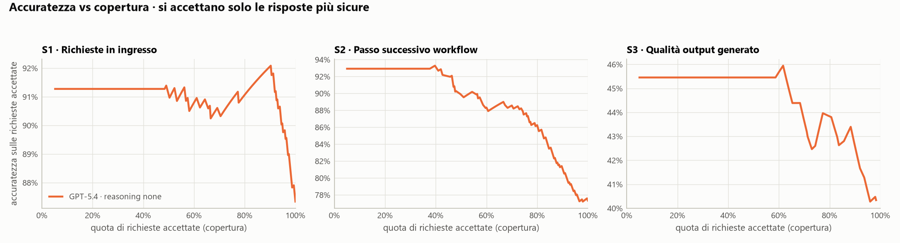

# Risultati del benchmark · run `main`

> Generato da `jevbench report` il 2026-11-06T20:47:35+00:00 (UTC). Modelli effettivamente serviti: `gpt-5.4-2026-03-05`.
> Metodologia, limiti e interpretazione: [docs/03-metodologia.md](../../docs/03-metodologia.md) e [docs/04-risultati-e-raccomandazioni.md](../../docs/04-risultati-e-raccomandazioni.md).

> **Attenzione:** in questo run mancano le predizioni di Jev (serve `TYPESAFE_API_KEY` in `.env`, poi `jevbench run --systems jev`).

## Sintesi

| Scenario | Sistema | Accuratezza [IC 95%] | Metrica secondaria | Latenza p50 (ms) | Latenza p95 (ms) | Costo / 1.000 richieste |
|---|---|---|---|---|---|---|
| S1 · Richieste in ingresso | GPT-5.4 · reasoning none | 87.3% [83.4–90.9] | macro-F1 0.868 | 1,162 | 2,457 | $1.19 |
| S1 · Richieste in ingresso | GPT-5.4 · reasoning medium | 88.3% [84.7–91.6] | macro-F1 0.874 | 1,519 | 2,818 | $2.14 |
| S2 · Passo successivo workflow | GPT-5.4 · reasoning none | 77.3% [72.3–82.0] | macro-F1 0.774 | 1,206 | 1,888 | $3.27 |
| S2 · Passo successivo workflow | GPT-5.4 · reasoning medium | 80.0% [75.3–84.7] | macro-F1 0.804 | 2,274 | 19,236 | $7.69 |
| S3 · Qualità output generato | GPT-5.4 · reasoning none | 39.7% [34.3–45.3] | QWK 0.567 | 1,147 | 1,889 | $2.02 |
| S3 · Qualità output generato | GPT-5.4 · reasoning medium | 45.0% [39.3–50.7] | QWK 0.620 | 2,803 | 4,979 | $4.69 |

## Qualità

<picture><source media="(prefers-color-scheme: dark)" srcset="figures/quality-dark.png"></picture>

### S1 - Classificazione delle richieste in ingresso

Dataset: Banking77 (PolyAI, Casanueva et al. 2020), split test, CC BY 4.0. Opzioni: 77.

| Sistema | n | errori API | Accuratezza | IC 95% | Macro-F1 | IC 95% |
|---|---|---|---|---|---|---|
| GPT-5.4 · reasoning none | 308 | 0 | 87.3% | [83.4–90.9] | 0.868 | [0.811–0.890] |
| GPT-5.4 · reasoning medium | 308 | 0 | 88.3% | [84.7–91.6] | 0.874 | [0.819–0.898] |

### S2 - Decisione del passo successivo in un workflow

Dataset: ABCD v1.1 (ASAPP, Chen et al. NAACL 2021), split test (+dev for rare actions), MIT. Opzioni: 30.

| Sistema | n | errori API | Accuratezza | IC 95% | Macro-F1 | IC 95% |
|---|---|---|---|---|---|---|
| GPT-5.4 · reasoning none | 300 | 0 | 77.3% | [72.3–82.0] | 0.774 | [0.716–0.809] |
| GPT-5.4 · reasoning medium | 300 | 0 | 80.0% | [75.3–84.7] | 0.804 | [0.749–0.839] |

### S3 - Valutazione della qualita' di un output generato

Dataset: HelpSteer2 (NVIDIA, Wang et al. 2024), split validation, CC BY 4.0. Opzioni: 5.

| Sistema | Risposte | Esatta | Entro ±1 | MAE | QWK [IC 95%] | Spearman | Gate ≥3: accuratezza | Gate ≥3: F1 | Livello medio previsto (umano) |
|---|---|---|---|---|---|---|---|---|---|
| GPT-5.4 · reasoning none | 295/300 | 39.7% | 79.0% | 0.85 | 0.567 [0.484–0.644] | 0.625 | 72.5% | 0.576 | 1.74 (2.00) |
| GPT-5.4 · reasoning medium | 295/300 | 45.0% | 82.7% | 0.76 | 0.620 [0.541–0.695] | 0.641 | 74.9% | 0.626 | 1.76 (2.00) |

*Esatta* conta le richieste fallite come errori; le altre metriche sono calcolate sulle richieste con risposta. Spearman usa il punteggio atteso (media pesata dei livelli) quando disponibile. *Gate ≥3*: decisione binaria accetta/rifiuta (helpfulness ≥ 3).

<picture><source media="(prefers-color-scheme: dark)" srcset="figures/confusion-dark.png"></picture>

## Latenza

<picture><source media="(prefers-color-scheme: dark)" srcset="figures/latency-dark.png"></picture>

| Scenario | Sistema | Media | p50 | p90 | p95 | p99 | Server p50 |
|---|---|---|---|---|---|---|---|
| S1 · Richieste in ingresso | GPT-5.4 · reasoning none | 1,302 | 1,162 | 1,890 | 2,457 | 2,962 | – |
| S1 · Richieste in ingresso | GPT-5.4 · reasoning medium | 1,677 | 1,519 | 2,408 | 2,818 | 4,695 | – |
| S2 · Passo successivo workflow | GPT-5.4 · reasoning none | 1,308 | 1,206 | 1,589 | 1,888 | 3,943 | – |
| S2 · Passo successivo workflow | GPT-5.4 · reasoning medium | 4,810 | 2,274 | 10,610 | 19,236 | 30,914 | – |
| S3 · Qualità output generato | GPT-5.4 · reasoning none | 1,236 | 1,147 | 1,549 | 1,889 | 3,216 | – |
| S3 · Qualità output generato | GPT-5.4 · reasoning medium | 3,066 | 2,803 | 4,298 | 4,979 | 7,559 | – |

Latenze in millisecondi, misurate lato client sul tentativo andato a buon fine (connessioni già aperte da una richiesta di warm-up). *Server p50* è il tempo di elaborazione dichiarato dal gateway TypeSafe (`x-envoy-upstream-service-time`); Azure non espone un equivalente.

## Costo

| Scenario | Sistema | USD / 1.000 richieste | Token input medi | Input in cache | Token output medi | di cui reasoning | Costo del run |
|---|---|---|---|---|---|---|---|
| S1 · Richieste in ingresso | GPT-5.4 · reasoning none | $1.19 | 1,810 | 89% | 19 | 0 | $0.366 |
| S1 · Richieste in ingresso | GPT-5.4 · reasoning medium | $2.14 | 1,810 | 88% | 81 | 60 | $0.660 |
| S2 · Passo successivo workflow | GPT-5.4 · reasoning none | $3.27 | 1,522 | 23% | 18 | 0 | $0.980 |
| S2 · Passo successivo workflow | GPT-5.4 · reasoning medium | $7.69 | 1,522 | 39% | 348 | 329 | $2.31 |
| S3 · Qualità output generato | GPT-5.4 · reasoning none | $2.02 | 721 | 0% | 15 | 0 | $0.596 |
| S3 · Qualità output generato | GPT-5.4 · reasoning medium | $4.69 | 721 | 0% | 193 | 176 | $1.38 |

Prezzi applicati: Jev 0.042 $/M token input, output gratuito ([fonte](https://docs.typesafe.ai/models.md)); GPT-5.4 2.5 $/M input, 0.25 $/M input in cache, 15.0 $/M output ([fonte](https://techcommunity.microsoft.com/blog/azure-ai-foundry-blog/introducing-gpt-5-4-in-microsoft-foundry/4499785)). I token di Jev e di GPT-5.4 sono contati da tokenizer diversi.

## Calibrazione e confidenza

<picture><source media="(prefers-color-scheme: dark)" srcset="figures/calibration-dark.png"></picture>

<picture><source media="(prefers-color-scheme: dark)" srcset="figures/selective-dark.png"></picture>

| Scenario | Sistema | ECE ↓ | Brier ↓ | AUROC giusto/sbagliato ↑ | Risposte con p ≥ 0,99 |
|---|---|---|---|---|---|
| S1 · Richieste in ingresso | GPT-5.4 · reasoning none | 0.122 | 0.119 | 0.660 | 95% |
| S2 · Passo successivo workflow | GPT-5.4 · reasoning none | 0.226 | 0.219 | 0.767 | 86% |
| S3 · Qualità output generato | GPT-5.4 · reasoning none | 0.523 | 0.509 | 0.574 | 60% |

La probabilità usata è quella assegnata alla risposta scelta: per Jev la `probabilities[choice]`, per GPT-5.4 senza reasoning la probabilità della sequenza di token della label (logprobs). Con reasoning attivo l'API non restituisce logprobs.

